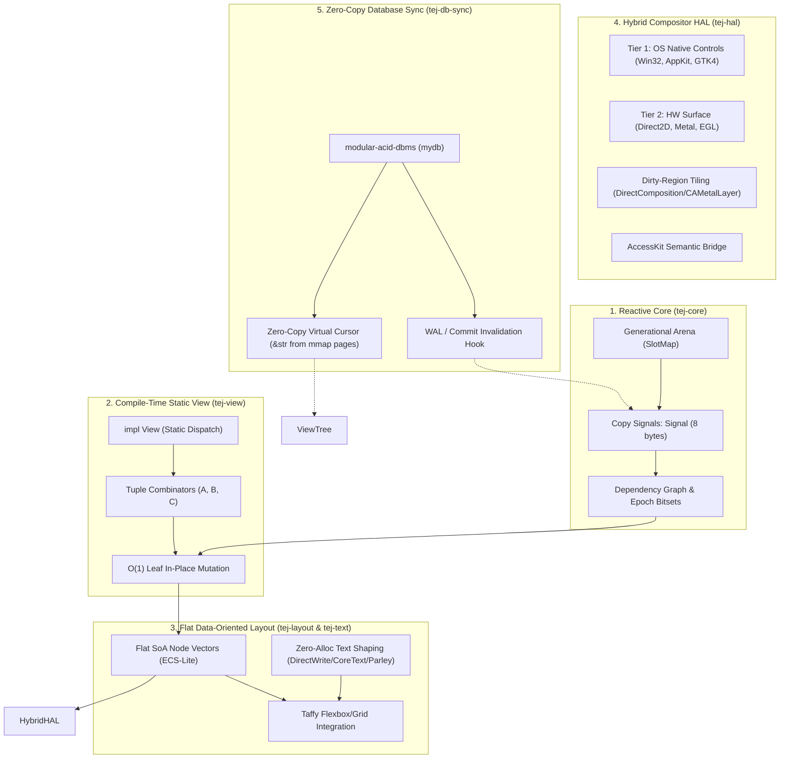

# `tej-ui` Architecture Specification

## 1. Executive Summary & Design Vision

`tej-ui` is a high-performance, modular cross-platform UI framework for Rust designed to break the traditional **"WebView vs. Game-Engine Canvas"** binary.

Existing Rust UI solutions impose painful trade-offs:
- **WebViews (Tauri, Dioxus Desktop):** Fast ergonomics and native web CSS, but 80–200 MB idle RAM overhead and inter-process serialization latencies.
- **Pure GPU Canvases (GPUI, Iced, egui):** High framerates, but consume 60–120 MB idle RAM (due to full 4K swapchains and texture allocations) while languishing in the "uncanny valley" of non-native text input, lack of OS scroll inertia, and poor accessibility.
- **Compiled DSLs (Slint):** Tiny footprint, but requires a proprietary foreign DSL and limits deep Rust compiler optimizations.
- **Native Core + Shell (Crux, NSH):** True native UI, but disjointed state management across multi-language bridges.

`tej-ui` solves this by introducing a **Modular Hybrid-Compositor Framework** driven by **Generational Arena Signals** and **Zero-Copy Database Integration** with the `mydb` ACID DBMS engine.

---

## 2. Comparative Architectural Matrix

| Metric / Dimension | OS WebView (Tauri) | Pure GPU Canvas (Iced, GPUI) | Compiled DSL (Slint) | Native Core + Shell (Crux) | `tej-ui` (Proposed) |
|---|---|---|---|---|---|
| **Binary Size** | 3 – 8 MB | 8 – 25 MB | 1 – 4 MB | 2 – 6 MB | **1.5 – 3.5 MB** |
| **Idle RAM (4K Display)** | 80 – 200 MB | 60 – 120 MB | < 5 MB | 15 – 35 MB | **10 – 22 MB** |
| **Controls & Look** | Web Polyfill | Custom GPU Shaders | Custom Engine | Platform Native | **Tier-1 OS Native + Tier-2 GPU** |
| **Scroll / IME / A11y** | Browser Engine | Re-implemented | Re-implemented | OS Native | **OS Native Retained Compositor** |
| **State Paradigm** | IPC JSON / Binary | MVU / Elm / Message | Reactive DSL | Event/Command Bus | **Generational Arena Signals (`Copy`)** |
| **Data Rendering** | Serialization Copy | Heap Clone `Vec<T>` | Property Copy | FFI Serialization | **Zero-Copy `mmap` Page Slices** |

---

## 3. Core Architectural Pillars



### Pillar 1: Generational Arena Signals (`tej-core`)
- **Problem Solved:** Borrow checker friction with callbacks and cyclic UI trees (`Rc<RefCell<T>>` or `Arc<Mutex<T>>`).
- **Mechanism:**
  - Reactive state lives in a thread-local or synchronized generational arena (`SlotMap<SignalId, SignalSlot<T>>`).
  - `Signal<T>` is an 8-byte `Copy` struct containing:
    ```rust
    #[derive(Clone, Copy, PartialEq, Eq, Hash, Debug)]
    pub struct Signal<T: 'static> {
        pub id: u32,
        pub generation: u32,
        pub _marker: PhantomData<fn() -> T>,
    }
    ```
  - Being `Copy`, closures and event handlers capture signals by value without `.clone()` or explicit lifetime annotations.
  - Dependency tracking is maintained in an optimized DAG with generational epoch stamps, guaranteeing **glitch-free propagation** in topological order.

### Pillar 2: Compile-Time Static View Trees (`tej-view`)
- **Problem Solved:** Virtual DOM heap allocation overhead (diffing tree nodes on each frame) and immediate-mode redraw CPU consumption.
- **Mechanism:**
  - View trees are statically typed (`impl View`) composed via tuples:
    ```rust
    impl<A: View, B: View> View for (A, B) { ... }
    ```
  - When an arena signal changes, it triggers an invalidation bit on the exact associated leaf widget.
  - The framework performs an $O(1)$ in-place update on the underlying target widget property without allocating or diffing virtual nodes.

### Pillar 3: Data-Oriented Layout & System Text (`tej-layout`, `tej-text`)
- **Problem Solved:** Pointer-heavy tree allocations for layout nodes.
- **Mechanism:**
  - Layout structures are stored in flat Structure-of-Arrays (`SoA`) vectors (`LayoutStorage`).
  - Flat arenas implement `taffy::TraversePartialTree` directly, avoiding tree duplication.
  - Text measurement delegates directly to OS system font caches and formatters (`DirectWrite` on Windows, `CoreText` on macOS, `Fontconfig/HarfBuzz/Parley` on Linux), eliminating heavy bundled fonts.

### Pillar 4: The Hybrid Compositor Model (`tej-hal`)
- **Tier 1 — OS Retained Native Controls:**
  - Standard controls (text fields, search inputs, dialogs, scroll bars, window buttons) are mounted as genuine OS window controls (`HWND` on Windows, `NSView` on macOS, `GtkWidget` on Linux).
  - Inherits authentic IME composition, accessibility hooks, context menus, and kinetic scrolling out-of-the-box.
- **Tier 2 — Hardware-Accelerated Custom Surfaces:**
  - Complex custom graphics (e.g. data grids, node graphs, real-time charts) are hosted on lightweight embedded native surfaces backed by the OS built-in 2D engine (`Direct2D`, `CoreAnimation`/`Metal`, `EGL`/`Cairo`).
- **Dirty-Region Composition:**
  - Never allocates full-window 4K backing textures. The OS compositor (`DirectComposition`, `CAMetalLayer`) is instructed only to present rasterized dirty rectangles.

### Pillar 5: Zero-Copy Database-Driven State (`tej-db-sync`)
- **Problem Solved:** The triple-copy penalty (Disk/DB $\to$ Struct deserialization $\to$ State store $\to$ UI widget string).
- **Mechanism:**
  - `tej-db-sync` links directly with the modular ACID DBMS (`mydb`).
  - **WAL Commit Hooks:** Database write transactions publish modified page/table ranges directly to reactive signal IDs.
  - **Zero-Copy Virtual List:** The virtual scroll container binds to an active `mmap` read transaction snapshot. During layout and paint, visible row slices (`&str`, `&[u8]`) are referenced directly from the database's slotted pages.
  - Memory consumption remains flat ($O(\text{viewport rows})$) whether browsing 50 or 5,000,000 records.

---

## 4. Crate Modular Breakdown

Following the design established in `modular-acid-dbms`, each module in `tej-ui` is isolated into an independent crate under `crates/`:

1. **`tej-core`**: Core reactivity primitives, generational arenas, signals, computed derivations, effects, and scheduler.
2. **`tej-view`**: Static view traits, tuple composition macros, primitive widgets (`VStack`, `HStack`, `Text`, `Button`, `Checkbox`), and control-flow combinators.
3. **`tej-layout`**: SoA layout arena and `Taffy` Flexbox/Grid bridge.
4. **`tej-text`**: System font integration and glyph metrics.
5. **`tej-hal`**: Hardware abstraction interfaces, window management abstractions, dirty region tracker.
6. **`tej-platform-linux`**: Linux implementation using GTK4 / Wayland / X11.
7. **`tej-platform-windows`**: Windows implementation using Win32 / DirectComposition / Direct2D.
8. **`tej-platform-macos`**: macOS implementation using AppKit / CoreAnimation.
9. **`tej-platform-web`**: WebAssembly target using Canvas / DOM.
10. **`tej-a11y`**: Semantic accessibility integration with `AccessKit`.
11. **`tej-db-sync`**: Direct reactive binding and zero-copy cursors for `mydb`.
12. **`tej`**: Top-level umbrella crate with prelude, declarative macros, and default backend wiring.
