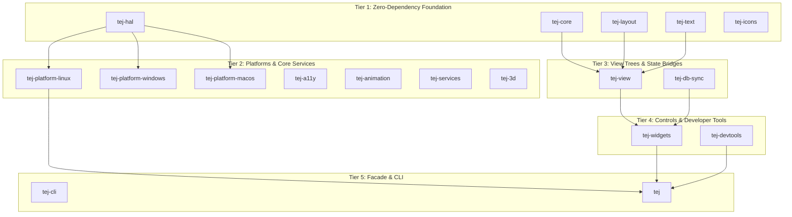

# Crates.io Publishing & Distribution Readiness Guide

This document details the exact requirements, dependency ordering, metadata additions, and technical blockers that must be resolved to publish `tej-ui` and its modular sub-crates to [crates.io](https://crates.io).

---

## 1. Summary of Blockers & Required Changes

| Area | Current State | Required Fix for Crates.io | Severity |
| :--- | :--- | :--- | :--- |
| **`mydb` Path Dependency** | `mydb` and `mydb-core` are declared as local relative path dependencies (`../modular-acid-dbms/...`) without a crates.io version. | Crates.io rejects packages depending on external path dependencies. Either: (1) `mydb` and `mydb-core` must be published to crates.io first, or (2) `mydb` must be an optional feature in `tej-db-sync`. | **CRITICAL BLOCKER** |
| **Workspace Dependency Versions** | Internal crates in `Cargo.toml` specify `{ path = "crates/..." }` without `version = "0.1.0"`. | Add `version = "0.1.0"` to every internal dependency in `[workspace.dependencies]`. | **CRITICAL BLOCKER** |
| **Root & Crate READMEs** | Root `README.md` was missing (now generated), individual crate READMEs needed. | Ensure root `README.md` is present and crate manifests point to either crate README or workspace README. | **RESOLVED / HIGH** |
| **Package Metadata** | Crate `Cargo.toml` files lack `description`, `repository`, `documentation`, `keywords`, `categories`. | Add `[workspace.package]` metadata inheritance or per-crate fields. Crates.io rejects packages lacking `description`. | **HIGH (Cargo Rejects)** |
| **Private Workspace Crates** | `examples/*`, `benches`, `tests` do not specify `publish = false`. | Add `publish = false` to `examples/task-manager/Cargo.toml`, `examples/obsidian-clone/Cargo.toml`, `benches/Cargo.toml`, and `tests/Cargo.toml`. | **HIGH (Prevents accidental publish)** |
| **Topological Publishing Order** | All 18 crates cannot be published simultaneously. | Crates must be published in strict bottom-up dependency DAG order with propagation pauses. | **PROCESS REQUIREMENT** |

---

## 2. Technical Solution for the `mydb` Dependency

`tej-db-sync` links directly to `mydb` and `mydb-core`. When packaging `tej-db-sync` with `cargo package`, cargo outputs:

```
error: all dependencies must have a version requirement specified when packaging.
dependency `mydb` does not specify a version
```

### Path A: Publish `mydb` to Crates.io First (Recommended)
1. Navigate to `/home/yeab/Projects/Work/modular-acid-dbms`.
2. Publish `mydb-core` v0.1.0 to crates.io:
   ```bash
   cargo publish -p mydb-core
   ```
3. Publish `mydb` v0.1.0 to crates.io:
   ```bash
   cargo publish -p mydb
   ```
4. Update `tej-ui/Cargo.toml`:
   ```toml
   [workspace.dependencies]
   mydb = { version = "0.1.0", path = "../modular-acid-dbms/crates/mydb" }
   mydb-core = { version = "0.1.0", path = "../modular-acid-dbms/crates/mydb-core" }
   ```

### Path B: Optional Feature-Gated Database Adapter
If publishing `tej-ui` before `mydb` is on crates.io:
1. Make `mydb` an optional dependency in `crates/tej-db-sync/Cargo.toml`:
   ```toml
   [dependencies]
   mydb = { version = "0.1.0", path = "../modular-acid-dbms/crates/mydb", optional = true }
   ```
2. Define a generic `StorageEngine` trait in `tej-db-sync` that works in-memory without `mydb`, enabling `tej-db-sync` and `tej` to be published immediately.

---

## 3. Package Metadata Manifest Specifications

In the root `Cargo.toml`:

```toml
[workspace.package]
version = "0.1.0"
edition = "2024"
rust-version = "1.85.0"
authors = ["Yeabsira Bezabih <ets1389@aastu.edu.et>"]
license = "MIT OR Apache-2.0"
readme = "README.md"
repository = "https://github.com/your-username/tej-ui"
homepage = "https://github.com/your-username/tej-ui"
documentation = "https://docs.rs/tej"
keywords = ["gui", "ui", "reactive", "zero-copy", "desktop"]
categories = ["gui", "rendering", "development-tools"]
```

In each individual crate's `Cargo.toml`, inherit from workspace:

```toml
[package]
name = "tej-core"
version.workspace = true
edition.workspace = true
rust-version.workspace = true
authors.workspace = true
license.workspace = true
repository.workspace = true
homepage.workspace = true
documentation = "https://docs.rs/tej-core"
readme.workspace = true
description = "Generational arena, 8-byte Copy Signal reactive core with glitch-free DAG evaluation for tej-ui."
keywords = ["reactivity", "signals", "arena", "gui", "slotmap"]
categories = ["gui", "data-structures"]
```

---

## 4. Strict Topological Publication Order (DAG)

Crates.io indexes crate versions asynchronously. Each tier must be published and confirmed live on crates.io before the next tier can be uploaded.



### Release Execution Script

```bash
#!/usr/bin/env bash
set -euo pipefail

echo "==> Publishing Tier 1: Leaf Foundation Crates"
cargo publish -p tej-icons
cargo publish -p tej-core
cargo publish -p tej-layout
cargo publish -p tej-text
cargo publish -p tej-hal

echo "Sleeping 30s for crates.io index sync..."
sleep 30

echo "==> Publishing Tier 2: Platforms & Services"
cargo publish -p tej-a11y
cargo publish -p tej-animation
cargo publish -p tej-services
cargo publish -p tej-3d
cargo publish -p tej-platform-linux
cargo publish -p tej-platform-windows
cargo publish -p tej-platform-macos

echo "Sleeping 30s for crates.io index sync..."
sleep 30

echo "==> Publishing Tier 3: View & Database Sync"
cargo publish -p tej-view
cargo publish -p tej-db-sync

echo "Sleeping 30s for crates.io index sync..."
sleep 30

echo "==> Publishing Tier 4: Widgets & Devtools"
cargo publish -p tej-widgets
cargo publish -p tej-devtools

echo "Sleeping 30s for crates.io index sync..."
sleep 30

echo "==> Publishing Tier 5: Umbrella Facade & CLI"
cargo publish -p tej-cli
cargo publish -p tej

echo "==> All 18 tej-ui crates published successfully!"
```

---

## 5. Pre-Flight Verification Checklist

Before running `cargo publish`:

- [ ] Run `cargo package --workspace --no-verify` to ensure every manifest packages without error.
- [ ] Confirm `publish = false` on `examples/*`, `benches`, and `tests`.
- [ ] Ensure clean git working directory (`git status --porcelain` is empty).
- [ ] Check docs build cleanly with:
  ```bash
  RUSTDOCFLAGS="-D warnings" cargo doc --no-deps --all-features
  ```
- [ ] Verify crates.io API token is registered:
  ```bash
  cargo login <YOUR_CRATES_IO_TOKEN>
  ```
