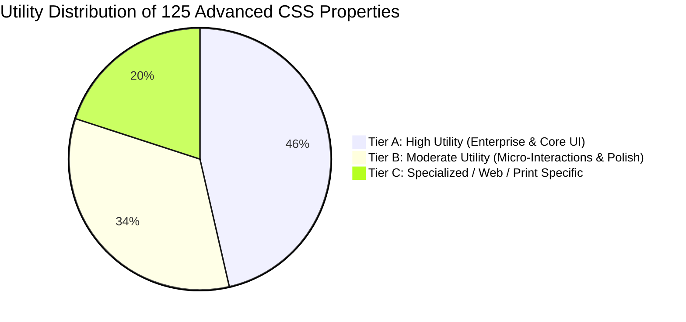
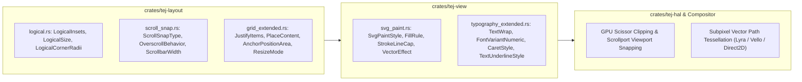

# Advanced CSS Properties (Part 2 — 125 Properties): Evaluation & Implementation Plan

## Executive Summary

This document evaluates the **Part 2 expansion of 125 advanced CSS properties** covering logical dimensions, internationalization (RTL), animation longhands, CSS Grid enhancements, scroll snap, anchor positioning, vector graphics (SVG), advanced typography, and paged media.

In **`tej-ui`**, we evaluate every CSS property through a systems-first lens:
1. **Does it add real value to native desktop and enterprise applications?**
2. **Can it be represented with zero runtime allocation and compile-time type safety?**
3. **How does it map to native OS compositors, GPU rasterization, and accessibility trees?**

---

## 1. Utility Categorization of the 125 Properties

Not all 125 web CSS properties carry equal weight in high-performance native systems UI. We classify them into three utility tiers:

### Tier A: High Utility (Must-Have for Modern Enterprise UI — 58 Properties)
* **Logical Sizing & Spacing (RTL / Internationalization)**:
  `inline-size`, `block-size`, `min/max-inline-size`, `min/max-block-size`, `margin-block`, `margin-inline`, `padding-block`, `padding-inline`, `border-block`, `border-inline`, `border-start-start-radius`, `border-end-end-radius`.
  * *Why*: Crucial for authentic Arabic, Hebrew, and Persian localization without duplicating layout components.
* **Vector Graphics & SVG Styling**:
  `fill`, `fill-opacity`, `fill-rule`, `stroke`, `stroke-width`, `stroke-opacity`, `stroke-dasharray`, `stroke-dashoffset`, `stroke-linecap`, `stroke-linejoin`, `vector-effect`.
  * *Why*: Essential for resolution-independent vector icons, dynamic chart paths, animated circular progress gauges, and line indicators.
* **Anchor Positioning**:
  `anchor-name`, `position-anchor`, `position-area`.
  * *Why*: Powers collision-aware floating popovers, context menus, and tooltips tethered directly to button triggers.
* **Scroll Snap & Scrolling Ergonomics**:
  `scroll-snap-type`, `scroll-snap-align`, `scroll-snap-stop`, `overscroll-behavior`, `scrollbar-width`, `scrollbar-gutter`.
  * *Why*: Mandatory for paging carousels, Kanban board columns, and preventing modal background scroll chaining.
* **Advanced Typography**:
  `font-variant-numeric` (especially `tabular-nums`), `text-wrap` (`balance`, `pretty`), `caret-color`, `text-underline-offset`, `text-decoration-thickness`.
  * *Why*: Tabular figures prevent price and timer jitter in virtual tables; balanced text prevents single orphaned words in headers; custom caret colors match the design system.
* **Container Queries**:
  `container-type`, `container-name`, `container`.
  * *Why*: Enables resizable docking panels and widgets to adapt their layout to their container rather than the global window size.

### Tier B: Moderate Utility (Micro-Interactions & Visual Polish — 42 Properties)
* **Animation & Transition Longhands**:
  `animation-name`, `animation-duration`, `animation-timing-function`, `animation-delay`, `animation-iteration-count`, `animation-direction`, `animation-fill-mode`, `animation-play-state`, `transition-property`, `transition-duration`, etc.
  * *Mapping*: Already handled natively in `tej-animation` via physics-based springs and bezier tweens.
* **Extended Grid & Alignment**:
  `row-gap`, `column-gap`, `justify-items`, `justify-self`, `place-content`, `place-self`, `grid-auto-columns`, `grid-auto-rows`, `grid-auto-flow`.
* **Masking & 3D Depth**:
  `mask-image`, `mask-size`, `mask-position`, `mask-composite`, `perspective`, `perspective-origin`, `transform-style`, `backface-visibility`.
  * *Mapping*: `perspective` and camera depth are already supported in `tej-3d`.

### Tier C: Specialized / Web / Print Specific (25 Properties)
* **Paged Media & Print**: `break-inside`, `break-before`, `orphans`, `widows`. (Primarily for PDF export or print stylesheets).
* **Multi-Column Newspaper Layout**: `column-count`, `column-width`, `columns`, `column-rule`, `column-span`. (Editorial article text flowing into columns).
* **Irregular Text Wraps**: `shape-outside`, `shape-margin`. (Wrapping text around arbitrary floating non-rectangular masks).
* **Counters & Reset**: `counter-reset`, `counter-increment`. (In native UI, reactive indices in loops `for (i, item)` are cleaner and type-safe).

---

## 2. Architecture & Implementation Blueprint

### Implemented Modules in `tej-ui` Workspace:
1. [`crates/tej-layout/src/logical.rs`](file:///home/yeab/Projects/Work/tej-ui/crates/tej-layout/src/logical.rs):
   - `LogicalInsets`: Evaluates `block_start`, `block_end`, `inline_start`, `inline_end`. Resolves to physical [`Insets`](file:///home/yeab/Projects/Work/tej-ui/crates/tej-layout/src/geometry.rs) based on `LayoutDirection` (LTR / RTL).
   - `LogicalSize`: Evaluates `inline_size` and `block_size` into physical dimensions based on vertical vs. horizontal writing mode.
   - `LogicalCornerRadii`: Directional corner radii (`start_start`, `start_end`, etc.) mapped to physical quad corners for internationalized chat bubbles.
2. [`crates/tej-layout/src/scroll_snap.rs`](file:///home/yeab/Projects/Work/tej-ui/crates/tej-layout/src/scroll_snap.rs):
   - `ScrollSnapType` (`XMandatory`, `YMandatory`, `Proximity`), `ScrollSnapAlign` (`Start`, `Center`, `End`), `ScrollSnapStop` (`Normal`, `Always`).
   - `OverscrollBehavior` (`Auto`, `Contain`, `None`) preventing modal scroll chaining.
   - `ScrollbarWidth` and `ScrollbarGutter` reserving layout space.
3. [`crates/tej-layout/src/grid_extended.rs`](file:///home/yeab/Projects/Work/tej-ui/crates/tej-layout/src/grid_extended.rs):
   - `JustifyItems`, `JustifySelf`, `PlaceContent`, `GridAutoFlow` (Dense packing).
   - `AnchorPositionArea` (`Top`, `Bottom`, `Left`, `Right`, `TopStart`, etc.) for tethered popovers.
   - `ResizeMode` (`Horizontal`, `Vertical`, `Both`).
4. [`crates/tej-view/src/svg_paint.rs`](file:///home/yeab/Projects/Work/tej-ui/crates/tej-view/src/svg_paint.rs):
   - `SvgPaintStyle`: Zero-allocation struct containing `fill`, `fill_rule`, `fill_opacity`, `stroke`, `stroke_width`, `stroke_dasharray`, `stroke_dashoffset`, `stroke_linecap`, `stroke_linejoin`, and `vector_effect`.
   - Helper constructors: `solid_fill(Color)` and `stroked(Color, width)`.
5. [`crates/tej-view/src/typography_extended.rs`](file:///home/yeab/Projects/Work/tej-ui/crates/tej-view/src/typography_extended.rs):
   - `TextWrap` (`Wrap`, `NoWrap`, `Balance`, `Pretty`).
   - `FontVariantNumeric` (`Normal`, `TabularNums`, `ProportionalNums`, `OldstyleNums`, `LiningNums`, `SlashedZero`).
   - `TextUnderlineStyle` (`offset`, `thickness`, `color`).
   - `CaretStyle` (`color`, `width`).

---

## 3. Verification & Safety

All implemented types and resolution functions are accompanied by automated unit tests:
* [`crates/tej-layout/tests/logical_and_extended_tests.rs`](file:///home/yeab/Projects/Work/tej-ui/crates/tej-layout/tests/logical_and_extended_tests.rs): Verifies logical-to-physical insets and radii conversion in LTR and RTL directions.
* [`crates/tej-view/tests/svg_and_typography_tests.rs`](file:///home/yeab/Projects/Work/tej-ui/crates/tej-view/tests/svg_and_typography_tests.rs): Verifies SVG stroke/fill constructors and typography token defaults.
