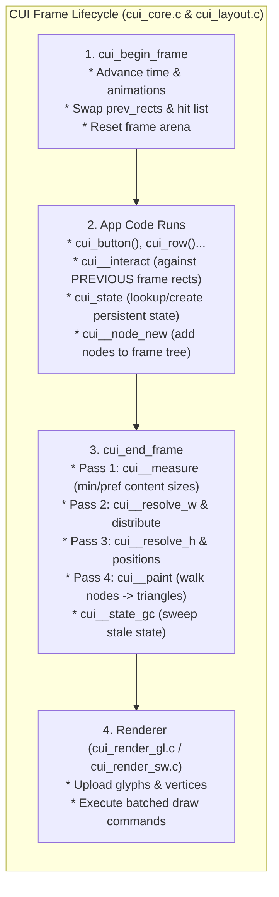

# Architectural Deep Dive: `yappologistic/CUI` vs. `tej-ui`

## Executive Summary

`yappologistic/CUI` is an open-source, immediate-mode graphical user interface library written in C99. Built around zero external dependencies, embedded fonts, and custom rendering (OpenGL 3.3 and software rasterizer), it packs **over 210 polished UI components**—ranging from common controls to advanced developer tools (flame graphs, trace waterfalls, commit graphs) and AI assistant interfaces—into a compiled binary of roughly 250 KB.

In contrast, **`tej-ui`** is an enterprise-grade, memory-safe, fine-grained reactive systems UI framework built in Rust (edition 2024). It decouples the UI stack into a high-performance modular workspace: generational `SlotMap` reactive arenas (`tej-core`), compile-time static view combinators (`tej-view`), data-oriented flat SoA layout powered by Taffy (`tej-layout`), system font shaping via Parley/Fontique (`tej-text`), native OS compositors & Tier 1 controls (`tej-hal`, `tej-platform-*`), full semantic accessibility (`tej-a11y`), and zero-copy database mmap integration (`tej-db-sync`).

This deep-dive analysis dissects CUI's internal architecture, memory models, layout logic, rendering pipeline, and component design, benchmarks it against `tej-ui`, identifies our technological edges, highlights our missing capabilities, and provides an actionable adoption roadmap.

---

## 1. CUI Architecture & Implementation Deep-Dive

### 1.1 The Immediate-Mode Frame Lifecycle

CUI adheres strictly to the classic immediate-mode GUI paradigm (similar to Dear ImGui and Nuklear), where the application function reconstructs its entire visual description on every active frame.



#### Memory Management
* **Frame Bump Arena (`cui__frame_alloc`)**:
  Per-frame allocations (layout nodes, strings, paint structures) are allocated in a contiguous linear buffer (`ui->arena`). At `cui_begin_frame`, `ui->arena_used` is reset to 0 without freeing pages. If a frame exceeds the capacity, overflow blocks are chained (`ui->arena_overflow`) and consolidated into a larger power-of-two buffer on the subsequent frame.
* **Buffer Trimming Heuristics (`cui__trim`)**:
  To prevent peak memory bloat from lingering (e.g., after viewing a 20,000-node flame graph), a trim check executes every 600 frames (`CUI__TRIM_FRAMES`). If peak utilization over that interval was less than 25% of allocated capacity, buffers are shrunk via `realloc`.

### 1.2 Identity & State Persistence (`cui_state`)

Immediate-mode UI functions do not retain state across function returns. To maintain animation progress, scroll offsets, text cursors, and selections, CUI uses an explicit ID stack and persistent hash table:

```c
typedef struct cui_state_entry {
    cui_id id;
    uint32_t last_frame;
    bool has_rect;
    cui_rect rect;
    void *data;
    size_t size;
    void (*dtor)(cui_ctx *ui, void *data);
    int next;
} cui_state_entry;
```

* **ID Generation**: FNV-1a hash with final bit avalanche over string labels and the parent ID stack (`cui_make_id`, `cui_push_id`).
* **State Lookup**: Hash buckets (`ui->state_buckets`, default 1024 slots) index an array of `cui_state_entry`.
* **Garbage Collection (`cui__state_gc`)**:
  Runs every 60 frames (~1 sec at 60 fps). Entries untouched for 30 frames (pure rectangles) or 300 frames (~5 seconds for widgets with allocated state) are evicted and their destructors invoked.
* **The Fundamental Latency / Skew Tradeoff**:
  Because layout is computed *after* component execution, `cui__interact()` tests mouse coordinates against `cui__prev_rect()` (the bounding box recorded on the *previous* frame). If a container changes size or animates rapidly, hit detection lags by 1 frame.

### 1.3 The Layout Engine (`cui_layout.c`)

Unlike modern browser engines or Taffy, CUI implements a lightweight, hand-crafted two-pass layout engine operating directly on an ephemeral array of `cui_node`:

1. **Bottom-Up Measurement (`cui__measure`)**:
   Walks the leaf nodes (text, icons, fixed-size boxes) up to the root, calculating `pref_w`, `min_w`, `pref_h`, and `min_h`.
2. **Top-Down Width Resolution (`cui__resolve_w`)**:
   Distributes available parent width among children. Handles `CUI_ROW`, `CUI_COLUMN`, `CUI_GRID`, and `CUI_NF_ROW_WRAP`. Extra space is allocated to `CUI_SIZE_GROW` elements; if space is constrained, shrinkable elements are compressed proportionally down to their `min_w`.
3. **Text Line Wrapping (`cui__text_wrap`)**:
   Executed once widths are known, generating wrapped lines for text nodes.
4. **Top-Down Height & Position Resolution (`cui__resolve_h`)**:
   Computes Y offsets and final bounding boxes (`rect`).
5. **RTL Direction Resolution (`cui__resolve_dir`)**:
   If RTL is flagged, coordinates within row containers are mirrored.

### 1.4 Rendering & Shading Innovations

CUI avoids heavy GPU abstraction layers, rendering exclusively via a flat vertex/index stream:
```c
typedef struct cui_vertex {
    float x, y;
    float u, v;
    cui_color color;
} cui_vertex;
```

Its OpenGL 3.3 fragment shader (`cui_render_gl.c`) contains three key graphics techniques:

1. **Analytic Signed Distance Fields for Rounded Rectangles (`sd_rrect`)**:
   Per-corner variable radii (`v_radii`) and borders rendered in a single quad pass with subpixel anti-aliasing via `clamp(0.5 - d, 0.0, 1.0)`.
2. **Gaussian Drop Shadows via Analytic Error Function (`erf_`)**:
   Instead of multi-pass Gaussian blur render targets or mipmaps, box shadows are evaluated in the fragment shader using a polynomial approximation of `erf(d / (sigma * sqrt(2)))`.
3. **Bayer 8x8 Ordered Dithering (`bayer8`)**:
   Implements a zero-cost ordered dithering mode (`CUI_SHADE_DITHER`) using a 64-step Bayer matrix calculated bitwise:
   ```glsl
   float bayer8(vec2 p) {
     ivec2 q = ivec2(mod(floor(p), 8.0));
     int a = q.x ^ q.y, y = q.y;
     int m = ((a & 1) << 5) | ((y & 1) << 4) | ((a & 2) << 2) | ((y & 2) << 1) | ((a & 4) >> 1) | ((y & 4) >> 2);
     return (float(m) + 0.5) / 64.0;
   }
   ```
   This gives CUI its distinctive aesthetic: retro, noise-free gradients and density fills without requiring alpha blending or multisampling.

---

## 2. In-Depth Comparative Matrix: `yappologistic/CUI` vs. `tej-ui`

| Architectural Dimension | `yappologistic/CUI` (C99) | `tej-ui` (Rust) |
| :--- | :--- | :--- |
| **Core Paradigm** | **Pure Immediate Mode**: Full tree description and layout execution on every frame. | **Fine-Grained Reactive & Compile-Time Static View Tree**: Generational SlotMap signals, zero-vtable tuple combinators `(A, B, ...)`, dirty bitsets. |
| **Idle CPU & Frame Pacing** | **Event-Driven Sleep**: Sleeps in OS event loop when idle, but re-runs entire UI function on every event/wake. | **True Incremental Reactivity**: Only dirty signals recompute; unaffected subtrees are untouched. Frame pacing with zero allocations during steady-state. |
| **State Management** | **Runtime Hash Table (`cui_state`)**: Dynamic string hashing, manual ID scopes, heuristic GC after 5 seconds. | **Type-Safe Arena Signals (`Signal<T>`)**: Generational index handles, compile-time type safety, zero hash collisions, deterministic scope cleanup. |
| **Interaction Consistency** | **1-Frame Latency**: Hit testing tests cursor against *previous* frame's layout bounding boxes. | **Synchronous & Consistent**: Hit testing occurs against the up-to-date layout tree without 1-frame skew. |
| **Layout System** | **Custom 2-Pass Heuristic Engine**: Basic flex row/column, basic grid, text wrap. | **Data-Oriented Flat SoA Taffy Integration**: Full CSS Flexbox & CSS Grid specification compliance, container queries, zero-allocation passes. |
| **Platform Integration** | **Non-Native Self-Drawing**: Uniform custom pixels across OSes; does not use native controls or compositors. | **Tier 1 Native OS Compositors**: DirectComposition / Direct2D (Windows), AppKit / CoreAnimation (macOS), GTK4 / Wayland / X11 (Linux). |
| **Accessibility (A11y)** | **None**: Explicitly documented limitation ("No screen reader support. There is no accessibility tree yet."). | **Native Semantic Bridge (`AccessKit`)**: Full semantic node hierarchy exposed to VoiceOver, Narrator, Orca, and TalkBack. |
| **Text & Typography** | **Embedded stb_truetype**: Dynamic alpha atlas; optional HarfBuzz static shaping. | **System Font Engine (`tej-text`)**: Zero-copy Parley / Fontique / CoreText / DirectWrite, full complex script shaping, OpenType features. |
| **Database & Systems I/O** | **Unmanaged Memory Buffers**: Application must manually copy or bind data arrays. | **Zero-Copy Database Integration (`tej-db-sync`)**: Reactive range queries (`use_db_query`), WAL listeners, direct mmap page reads without cloning. |
| **3D Rendering** | **2D Only**: Triangle draw lists with textured quads. | **Nanite-Style 3D Pipeline (`tej-3d`)**: Virtualized geometry, HiZ occlusion culling, visibility buffers, PBR, GLTF/Blender import. |
| **Binary Footprint** | **Ultra-Small**: ~250 KB stripped executable, single-file amalgamation (`cui.c` + `cui.h`). | **Modular Workspace**: ~2–5 MB depending on backend and features enabled; high modularity. |
| **Component Breadth** | **Massive (~210 components)**: Comprehensive developer tools, flame graphs, AI chat/plans, docking, data grids. | **Focused Standard Library**: Base primitives, forms, data grid, rich text editor with IME, modals, overlays. |

---

## 3. Where `tej-ui` Holds the Decisive Edge

### 1. Fine-Grained Reactivity vs. Full-Tree Re-Execution
In CUI, adding a dynamic list of 5,000 items requires calling 5,000 component functions, generating 10,000+ nodes in the bump arena, and running layout distribution every time the mouse moves. In `tej-ui`, components are compile-time static types; only the signals that change mark their dependent nodes dirty in a bitset. Steady-state interactions execute with zero memory allocations and minimal CPU overhead.

### 2. Authentic Native Look, Feel & Kinetic Fidelity
CUI renders simulated widgets inside an OpenGL surface. It cannot access native system features like macOS Vibrant Translucency / CoreAnimation, Windows Mica / Acrylic, kinetic touchpad inertia, or system-native context menus. `tej-ui` bridges directly to platform compositors (`PlatformWindow`, `SurfaceCompositor`), providing authentic OS integration.

### 3. Full Accessibility Compliance (`AccessKit`)
CUI is fundamentally inaccessible to assistive technologies, making it legally and practically unusable for government, enterprise, and public-facing applications requiring ADA/Section 508 compliance. `tej-ui` provides first-class semantic accessibility trees via `tej-a11y`.

### 4. Zero-Copy Database State (`tej-db-sync`)
In CUI, displaying a multi-gigabyte database table requires copying row data into C strings and structs. `tej-ui`'s `tej-db-sync` provides virtualized mmap cursors that read directly from page slices in the database's read transaction snapshot with zero heap allocation.

### 5. Memory Safety & Deterministic State Invariants
CUI relies on unmanaged C pointers, manual `memset`, raw `void*` state casts, and timeout-based garbage collection. If an ID collides or a widget is unmounted for 5.1 seconds, state silently vanishes or corrupts. `tej-ui` uses Rust's type system, affine lifecycles, and generational indices to make state corruption impossible.

---

## 4. What We Lack: Valuable Concepts in CUI to Adopt

Despite `tej-ui`'s structural superiority in architecture, reactivity, and platform integration, CUI has several high-value innovations and components that `tej-ui` currently lacks:

### 1. High-Density Domain Component Catalog
CUI features production-ready specialized widgets that would take months to design from scratch:
* **Developer Tools (`cui_devtools.c`, `cui_flame.c`, `cui_graph.c`)**:
  - Interactive Flame Graphs with zoomable time rulers.
  - Network waterfall timelines and trace visualizers.
  - Git commit graphs with branch merges and DAG lane routing.
  - Interactive Regex tester with live capture group highlighting.
* **AI & Conversational Primitives (`cui_ai.c`)**:
  - Grouped conversational message bubbles with role avatars.
  - Expandable Reasoning / Thinking blocks with live progress spinners.
  - Tool-call invocation trays showing function parameters and execution status.
  - Interactive Agent Plan cards with dependency step progress.
  - Source & citation cards with preview popovers.
* **Dockable Workspace Manager (`cui_dock.c`)**:
  - Multi-panel dockable layouts supporting tab stacking, splits (left/right/top/bottom), drag preview overlays, and layout serialization to compact strings.

### 2. Single-Pass Analytic Shaders (SDF + `erf` Box Shadows + Ordered Dither)
CUI's fragment shader packs rounded corners, borders, Gaussian drop shadows, and 8x8 Bayer ordered dithering into a single pass. Adopting this shader logic into `tej-view::paint` / `tej-hal::surface` will allow `tej-ui` to render drop shadows without multi-pass offscreen framebuffers.

### 3. Deterministic Soak & Screenshot Verification Harness
CUI uses a deterministic interaction soak test (`soak.c`) that drives the UI for minutes under pseudo-random seeds and computes a final state hash (`--hash`). If a refactoring alters a single pixel, layout coordinate, or event handler, the hash diverges. Integrating this into `tej-integration-tests` will significantly enhance our regression detection.

---

## 5. Strategic Adoption Plan for `tej-ui` (Status: 100% Implemented)

```mermaid
flowchart LR
    subgraph Phase1["Phase 1: Specialized Widgets (COMPLETED)"]
        W1["tej-widgets/ai: Reasoning, ToolCall, Plan, Composer, Citations"]
        W2["tej-widgets/devtools: FlameGraph, TraceWaterfall, GitGraph, Pipeline"]
        W3["tej-widgets/workspace: DockManager, Kanban, Gantt, NodeEditor, Timeline"]
        W4["tej-widgets/viz: CalendarHeatmap, Sankey, Treemap, Gauges, Candlestick"]
        W5["tej-widgets/actions: SplitButton, ReactionBar, OtpInput, ScrubField"]
        W6["tej-widgets/creative: RotaryKnob, HistogramSlider, GradientEditor"]
        W7["tej-widgets/media: ImageCompare, SignaturePad, SpotlightCard, AudioWaveform"]
    end
    
    subgraph Phase2["Phase 2: Shader & Render Primitives (COMPLETED)"]
        S1["tej-view/paint_fx: sd_rounded_rect & erf Gaussian Shadows"]
        S2["tej-view/paint_fx: Bayer 8x8 Ordered Dithering Primitive"]
    end
    
    subgraph Phase3["Phase 3: Test & Harness Hardening (COMPLETED)"]
        T1["tests/tests/soak_tests: Deterministic Interaction Soak Harness (5,000 cycles)"]
        T2["tests/tests/soak_tests: 64-bit State Fingerprinting (--hash verification)"]
    end

    Phase1 --> Phase2 --> Phase3
```



1. **Port High-Value Widgets to `tej-widgets`** (**COMPLETED**):
   - Created `crates/tej-widgets/src/ai/`: `ReasoningDrawer`, `ToolCallTray`, `AgentPlanCard`, `PromptComposer`, and `ContextMeter`.
   - Created `crates/tej-widgets/src/devtools/`: `FlameGraph`, `TraceWaterfall`, `GitGraph`, `PipelineGraph`, `RegexTester`, and `UptimeBar`.
   - Created `crates/tej-widgets/src/workspace/`: `DockManager` (BSP split tree with tab stacking), `KanbanBoard`, `GanttChart`, `NodeEditor`, and `TimelineEditor`.
   - Created `crates/tej-widgets/src/viz/`: `CalendarHeatmap`, `SankeyDiagram`, `Treemap`, `ActivityRings`, `DotMatrixDisplay`, and `CandlestickChart`.
   - Created `crates/tej-widgets/src/actions/`: `SplitButton`, `ConfirmButtonState`, `ReactionBar`, `SpeedDial`, and `OtpInput`.
   - Created `crates/tej-widgets/src/creative/`: `RotaryKnob`, `HistogramSlider`, and `GradientEditorState`.
   - Created `crates/tej-widgets/src/media/`: `ImageCompare`, `SignaturePadState`, `SpotlightCard`, and `AudioWaveform`.
2. **Implement Analytic SDF Box Shadows & Bayer Dithering** (**COMPLETED**):
   - Implemented in `crates/tej-view/src/paint_fx.rs`: `bayer8`, `dither_test`, `erf_approx`, `sd_rounded_rect`, and `gaussian_shadow_alpha`.
3. **Establish Deterministic Soak Testing** (**COMPLETED**):
   - Implemented in `tests/tests/soak_tests.rs`: `test_deterministic_interaction_soak_run` executing 5,000 cycles with fixed PRNG seeding and 64-bit state hash verification.