# `tej-ui` Enterprise Production Roadmap & Implementation Plan

This roadmap provides an execution blueprint to scale `tej-ui` into an enterprise-grade framework capable of powering mission-critical desktop software for major technology organizations (e.g., Linear, Figma, Discord, JetBrains).

---

## Strategic Architecture Overview

```mermaid
flowchart TD
    Core["tej-ui Core Architecture (Verified: 561KB, 2.38MB RAM)"] --> P1["Pillar 1: Native Platform Shells (Win32 & AppKit)"]
    Core --> P2["Pillar 2: Enterprise Component Kit (tej-widgets)"]
    Core --> P3["Pillar 3: Text Shaping & Global i18n (tej-text)"]
    Core --> P4["Pillar 4: Platform OS Services (tej-services)"]
    Core --> P5["Pillar 5: DevTools & Live Hot-Reload (tej-devtools)"]

    P1 --> Win["tej-platform-windows (DirectComposition/D2D)"]
    P1 --> Mac["tej-platform-macos (AppKit/CAMetalLayer)"]
    P1 --> DPI["Per-Monitor DPI & Multi-Window Router"]

    P2 --> Grid["Virtual DataGrid (100K cells, Pinning, Sorting)"]
    P2 --> Cmd["Command Palette (Cmd+K Fuzzy Engine)"]
    P2 --> Overlays["Overlays: Modals, Popovers, Context Menus"]

    P3 --> BiDi["BiDi Unicode Engine (Arabic/Hebrew RTL)"]
    P3 --> Fallback["System Glyph Fallback & Color Emoji"]

    P4 --> FileDialog["Native File Pickers & Drag-and-Drop"]
    P4 --> Clip["MIME Clipboard & Global Hotkeys"]

    P5 --> HotReload["State-Preserving Hot Reload (<150ms)"]
    P5 --> Inspector["Visual DAG Inspector & Dirty Rect HUD"]
```

---

## Pillar 1: Native Platform Shells (`tej-platform-windows`, `tej-platform-macos`)

### Objective
Provide Tier 1 native OS window shells with authentic system aesthetics (Windows 11 Mica/Acrylic, macOS AppKit vibrancies) and multi-monitor per-window DPI scaling.

### Deliverables
1. **`crates/tej-platform-windows`**:
   - `window.rs`: Win32 window procedure (`WndProc`), message loop dispatch, borderless snap layouts, dark/light theme DWM hooks (`DwmSetWindowAttribute`).
   - `composition.rs`: Windows DirectComposition visual tree integration, creating swapchains with zero blitting overhead.
   - `materials.rs`: Windows 11 Acrylic and Mica backdrop effects.
   - `dpi.rs`: `WM_DPICHANGED` handling with dynamic layout resizing.
2. **`crates/tej-platform-macos`**:
   - `window.rs`: AppKit `NSWindow` and `NSView` subclassing, unified toolbar titlebars, fullscreen Spaces integration.
   - `metal.rs`: `CAMetalLayer` composition for Tier 2 custom surfaces.
   - `vibrancy.rs`: `NSVisualEffectView` materials for native translucent sidebars.
3. **`crates/tej-hal` (Enhancement)**:
   - `multi_window.rs`: Multi-window coordination manager tracking separate layout arenas and dirty-rect accumulators per window.
   - `display.rs`: Monitor enumeration, physical DPI scale queries, and refresh rate synchronization (60Hz / 120Hz ProMotion).

### Verification Gate
- Seamless window dragging across 100% and 200% scaling monitors without blurry text or misaligned layout rects.
- Zero idle CPU wakeups when windows are obscured or minimized.

---

## Pillar 2: Enterprise Component Kit (`crates/tej-widgets`)

### Objective
Supply large engineering teams with standard, accessible, high-density enterprise UI patterns out-of-the-box.

### Deliverables
1. **`crates/tej-widgets` (New Crate)**:
   - **`datagrid/`**:
     - `grid.rs`: Virtualized 2D data grid capable of rendering 100,000 cells at 120 FPS.
     - `column.rs`: Resizable, draggable, and pinnable (left/right) column headers with sorting indicators.
     - `cell.rs`: Inline cell editors (text, dropdown, checkbox, numeric).
     - `mmap_adapter.rs`: Direct zero-copy integration with `mydb` table snapshots.
   - **`command_palette/`**:
     - `palette.rs`: Global `Cmd + K` search overlay.
     - `fuzzy.rs`: Zero-allocation Smith-Waterman or Bitap fuzzy matching algorithm over registered action registries.
     - `item.rs`: Command entry view supporting keyboard shortcuts, icons, and categories.
   - **`overlays/`**:
     - `modal.rs`: Accessible backdrop dialog with focus trapping and ESC dismissal.
     - `popover.rs`: Floating overlay anchored to source widget coordinates with collision detection against screen edges.
     - `context_menu.rs`: Native OS context menus (`NSMenu` on macOS, Win32 PopupMenu on Windows, GTK on Linux).
     - `toast.rs`: Non-blocking notification banner queue with autohide timers.
   - **`navigation/`**:
     - `tabs.rs`: Tabbed interface with keyboard arrow navigation.
     - `tree_view.rs`: Hierarchical directory tree view with virtualized collapsible nodes.

### Verification Gate
- DataGrid scrolling 100,000 rows x 50 columns with under 25 MB RAM and 0 steady-state allocations.
- Command Palette searching through 10,000 commands in under 1.5 milliseconds.

---

## Pillar 3: Complex Text Shaping & Global i18n (`crates/tej-text`)

### Objective
Achieve typographic parity with browsers and native OS editors for global multilingual applications.

### Deliverables
1. **`crates/tej-text` (Enhancement)**:
   - `bidi.rs`: Unicode Bidirectional Algorithm (UAX #9) detecting and reordering mixed LTR/RTL text runs (Arabic, Hebrew, Persian).
   - `shaper.rs`: Integration with `Parley` and `HarfBuzz` for complex script ligature shaping (Devanagari conjuncts, Arabic cursive joining, Thai vertical marks).
   - `fallback.rs`: Multi-tiered system font fallback chains (e.g., Segoe UI $\to$ Meiryo $\to$ Malgun Gothic $\to$ Noto Sans $\to$ Color Emoji).
   - `emoji.rs`: Zero-copy color emoji rasterization (DirectWrite color fonts on Windows, Apple Color Emoji on macOS, Noto Color Emoji on Linux).

### Verification Gate
- BiDi test suite: Correct visual ordering of mixed English and Arabic sentences.
- Complex script rendering verified against standard OpenType typography test cases.

---

## Pillar 4: Platform OS Services (`crates/tej-services`)

### Objective
Provide clean, idiomatic Rust abstractions for desktop OS integration without dragging in heavy C++ frameworks.

### Deliverables
1. **`crates/tej-services` (New Crate)**:
   - `dialogs.rs`: Native file picker (`open_file`, `save_file`, `select_folder`) using native OS dialog APIs.
   - `clipboard.rs`: System clipboard manager supporting UTF-8 text, PNG/JPEG image buffers, and custom application MIME types.
   - `dnd.rs`: Drag-and-drop file import and inter-widget item dragging.
   - `shortcuts.rs`: Global operating system hotkey hooks and application accelerators.
   - `tray.rs`: System tray icon / macOS menu bar status item with notification badges.
   - `security.rs`: OS secure credential storage (Windows Credential Manager, macOS Keychain, Linux Secret Service).

### Verification Gate
- File dialogs invoke native OS file pickers without thread blocking.
- Clipboard preserves high-resolution image data and custom metadata across processes.

---

## Pillar 5: Developer Tooling & Hot-Reloading (`crates/tej-devtools`)

### Objective
Provide sub-200ms iteration velocity and deep operational visibility for teams building large applications.

### Deliverables
1. **`crates/tej-devtools` (New Crate)**:
   - `hot_reload.rs`: Dynamic code reload engine leveraging shared library patching (`libloading`) or view tree serialization, preserving active `SignalArena` state across recompiles.
   - `dag_visualizer.rs`: Interactive debug overlay displaying the live reactive dependency graph, node depths, and subscriber counts.
   - `dirty_hud.rs`: Frame-rate and dirty-rectangle visualizer flashing highlighted bounds over areas presented to the compositor.
   - `layout_inspector.rs`: 3D visual hierarchy breakdown allowing developers to inspect margin, padding, and Flexbox constraints in real time.

### Verification Gate
- Modifying a view file and recompiling updates the running UI in under 200 ms while preserving active text input focus and database transactions.

---

## Execution Milestones & Timeline

| Milestone | Deliverables | Primary Crates | Success Criteria |
|---|---|---|---|
| **M1: Enterprise Foundations** | `ViewExt` Styling, Multi-Window HAL, Win32 & AppKit Shells | `tej-platform-windows`, `tej-platform-macos`, `tej-hal` | Windows & macOS windows boot at < 25 MB RAM with Mica/Vibrancy |
| **M2: Text & Global i18n** | HarfBuzz shaping, BiDi RTL/LTR engine, Font Fallbacks | `tej-text` | Mixed English/Arabic and CJK text render flawlessly |
| **M3: Enterprise Component Kit** | Virtual DataGrid, Command Palette (Cmd+K), Modals, Popovers | `tej-widgets` | 100K-row DataGrid operates at 120 FPS; Cmd+K search < 1.5 ms |
| **M4: Platform OS Services** | File dialogs, Clipboard, Drag-and-Drop, System Tray | `tej-services` | Native file open/save and clipboard exchange working on all OSes |
| **M5: DevTools & Hot-Reload** | Live state-preserving hot reload, Reactive DAG HUD | `tej-devtools` | Sub-200ms view updates without state reset |

---

## Quality & Verification Mandate

Every crate and feature developed under this roadmap must satisfy the strict standards set in [**`AGENTS.md`**](file:///home/yeab/Projects/Work/tej-ui/AGENTS.md):
- **< 500 lines per file** with dedicated files for independent concepts.
- **Zero Clippy warnings** (`cargo clippy --all-targets --all-features`).
- **All unit, integration, and performance tests passing** (`cargo test -j 2`).
- **Strict zero-allocation invariants** in steady-state layout and paint hot-paths.
