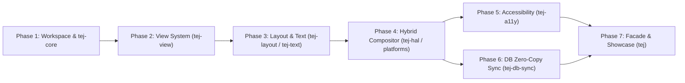

# `tej-ui` Implementation Plan

This roadmap provides a phased, milestone-driven execution plan for building `tej-ui`. Each phase is broken down into verifiable deliverables, modular crate assignments, and validation gates.

---

## Roadmap Overview

---

## Phase 1: Workspace Foundation & Core Reactive Runtime (`tej-core`)

### Objectives
Establish the workspace structure, developer tooling, lint policies, and build the zero-allocation generational arena reactive engine.

### Deliverables
1. **Workspace Root Setup**:
   - `Cargo.toml` with workspace definitions, strict lints, shared dependencies (`parking_lot`, `smallvec`, `thiserror`, `slotmap`).
   - Copy and activate `.cargo/config.toml`, `clippy.toml`, `.gitignore`.
2. **`crates/tej-core`**:
   - `arena.rs`: Generational `SlotMap` storage for reactive cells with 32-bit index + 32-bit generation key.
   - `signal.rs`: `Signal<T>` implementing `Copy`, `Clone`, `Debug`, `PartialEq`, `Eq`, `Hash`.
   - `runtime.rs`: Thread-local reactive runtime managing active subscriber stack and tracking contexts.
   - `graph.rs`: Dependency Directed Acyclic Graph (DAG) with topological sort and epoch versioning to guarantee glitch-free updates.
   - `computed.rs`: Derived reactive state (`Memo<T>` / `Computed<T>`) evaluated lazily or eagerly on epoch change.
   - `effect.rs`: Untracked and tracked side-effect listeners (`create_effect`).
   - `batch.rs`: Batching transaction runner (`batch(|| { ... })`) to prevent intermediate notifications.

### Verification Gate
- Unit tests for signal reads, writes, diamond dependency graphs, dynamic branch switches, and nested effects.
- 100% glitch-free verification under stress tests.
- Zero heap allocation during steady-state signal reads/writes.
- `cargo clippy` and `cargo fmt` passing cleanly.

---

## Phase 2: Static View System & Widget Primitives (`tej-view`)

### Objectives
Build the compile-time typed view tree framework that completely avoids Virtual DOM diffing and heap-boxed nodes.

### Deliverables
1. **`crates/tej-view`**:
   - `view.rs`: `pub trait View` defining `build()`, `rebuild()`, and `patch()` lifecycles with associated state tokens.
   - `tuples.rs`: Macro-generated implementations of `View` for tuples up to `(A, B, C, ..., Z)` (up to 16 elements).
   - `primitives/`:
     - `text.rs`: Static text and reactive text bound to `Signal<String>`.
     - `button.rs`: Clickable interactive button with event callback closure.
     - `checkbox.rs`: Two-state toggle control bound to `Signal<bool>`.
     - `input.rs`: Single-line text input with reactive value and change listener.
     - `stacks.rs`: `VStack` and `HStack` linear flex layout view containers.
   - `control_flow/`:
     - `cond.rs`: Static `If` conditional view displaying alternate branches without dynamic heap boxing.
     - `iter.rs`: Keyed `For` loop view managing list items with stable identities.
   - `patch.rs`: Fine-grained $O(1)$ mutation router dispatching dirty signal bitsets to exact leaf node updates.

### Verification Gate
- Static dispatch verified: no `Box<dyn View>` required in common view combinations.
- Benchmarks verifying zero-allocation view reconstruction when signals trigger.

---

## Phase 3: Flat Layout Arena & System Text (`tej-layout`, `tej-text`)

### Objectives
Integrate high-speed Flexbox and CSS Grid layout without pointer-heavy DOM allocations, paired with zero-allocation system text metrics.

### Deliverables
1. **`crates/tej-layout`**:
   - `storage.rs`: Flat Structure-of-Arrays (`SoA`) node storage (`LayoutArena`).
   - `taffy_adapter.rs`: Direct implementation of `taffy::TraversePartialTree` on `LayoutArena` avoiding duplicate trees.
   - `geometry.rs`: Rect, Size, Point, and Insets data primitives.
   - `cache.rs`: Dirty layout propagation with subtree caching.
2. **`crates/tej-text`**:
   - `font.rs`: System font resolver querying native OS font registries (`DirectWrite` on Windows, `CoreText` on macOS, `Fontconfig` on Linux).
   - `shaper.rs`: High-performance text shaping interface with fallback to `Parley`/`Fontique`.
   - `measurement.rs`: Cached text bounding-box measurement for layout passes.

### Verification Gate
- Layout of 10,000 nested nodes executes in under 2 milliseconds.
- System font discovery correctly resolves standard sans-serif, serif, and monospaced system typefaces without bundled TTF/OTF files.

---

## Phase 4: Hybrid Compositor & Platform Backends (`tej-hal`, `tej-platform-*`)

### Objectives
Implement the 2-tier hybrid rendering pipeline: native retained OS chrome/controls (Tier 1) and hardware-accelerated 2D surface rendering (Tier 2).

### Deliverables
1. **`crates/tej-hal`**:
   - `window.rs`: Cross-platform window traits (`WindowHandle`, `WindowConfig`, `EventLoop`).
   - `control.rs`: Abstract native control attachment interface (`NativeWidgetAttachment`).
   - `surface.rs`: Surface canvas abstraction for Tier 2 custom graphics.
   - `dirty.rs`: Dirty rectangle accumulator and clip manager for tile-based invalidation.
   - `event.rs`: Unified input events (keyboard, mouse, touch, scroll, focus, IME composition).
2. **`crates/tej-platform-linux`**:
   - Native integration with GTK4 / Wayland / X11.
   - EGL / Cairo surface backing for custom canvas areas.
3. **`crates/tej-platform-windows`**:
   - Native Win32 window management and DirectComposition visual tree integration.
   - Direct2D / DirectWrite hardware acceleration for Tier 2 surfaces.
4. **`crates/tej-platform-macos`**:
   - AppKit window management with `NSView` hierarchy and `CAMetalLayer` composition.

### Verification Gate
- Windows run with < 20 MB idle RAM on high-DPI (4K) displays.
- Native controls display authentic OS styles, font rendering, and system context menus.

---

## Phase 5: Accessibility Integration (`tej-a11y`)

### Objectives
Expose custom canvas nodes and native widgets to assistive technologies through an official `AccessKit` bridge.

### Deliverables
1. **`crates/tej-a11y`**:
   - `tree.rs`: Accessibility node tree builder synchronized with `tej-layout` SoA rects.
   - `roles.rs`: Mapping of view primitives to ARIA/AccessKit roles (Button, Checkbox, TextField, List).
   - `actions.rs`: Action handler dispatching screen reader events (Click, Focus, Scroll) back to reactive signals.

### Verification Gate
- Verification using OS accessibility tools (Orca on Linux, Narrator on Windows, VoiceOver on macOS).

---

## Phase 6: Zero-Copy Modular ACID DBMS Sync (`tej-db-sync`)

### Objectives
Directly bind the `modular-acid-dbms` (`mydb`) storage engine to the UI framework's reactive core, eliminating intermediate serialization and data duplication.

### Deliverables
1. **`crates/tej-db-sync`**:
   - `listener.rs`: Commit-listener hook subscribing to `mydb` transaction commit events and WAL modifications.
   - `query_signal.rs`: `use_db_query` and `watch_range` primitives that invalidate UI signals only when watched key/table ranges change.
   - `cursor.rs`: Zero-copy snapshot cursor referencing memory-mapped page buffers (`&str`, `&[u8]`).
   - `virtual_list.rs`: `VirtualList` widget that computes viewport visibility and only pulls active visible rows from mmap pages during rendering.

### Verification Gate
- Virtual list smoothly scrolling 1,000,000 rows with memory usage staying strictly flat under 25 MB.
- Write transaction commits in `mydb` instantly update UI components watching the modified keys without reloading unaffected rows.

---

## Phase 7: Unified Facade, Benchmark Suite & Showcase (`tej`)

### Objectives
Provide the user-facing ergonomic API, complete benchmark harness, and showcase applications.

### Deliverables
1. **`crates/tej`**:
   - `prelude.rs`: Common imports (`Signal`, `View`, `VStack`, `HStack`, `Button`, `Text`, `use_db_query`).
   - Macros for declarative syntax and reactive binding.
2. **`examples/`**:
   - `counter`: Minimalist 1.5 MB binary demonstrating arena signals and OS native controls.
   - `task-manager`: Full-featured task manager powered by `mydb` with 1,000,000 virtualized items and reactive search.
3. **`benches/`**:
   - Startup time benchmarks (vs Tauri, Iced, GPUI).
   - Memory footprint under 4K displays.
   - Reactive signal throughput (1,000,000 updates/sec).
   - Virtual list scrolling framerate and latency.

### Verification Gate
- All workspace tests passing (`cargo test -j 2`).
- Zero clippy warnings across all workspace members.
- Binary size under 3.5 MB in release mode.
