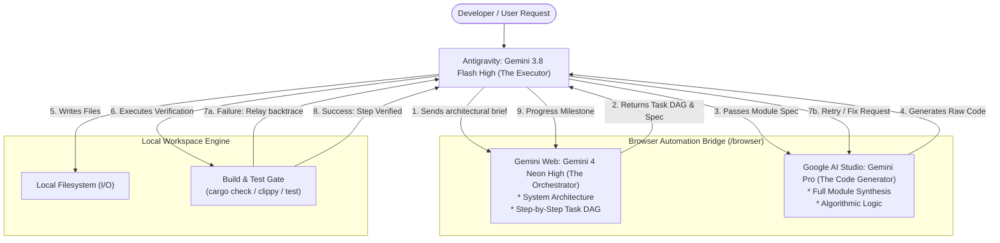
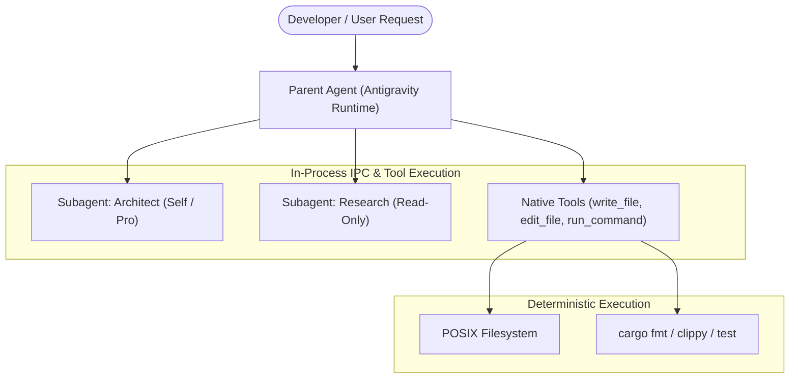

# Architectural Deep Dive: Browser-Automated Tri-Model Orchestration vs. Native Agent Frameworks

## Executive Summary

The proposed architecture addresses a real-world constraint: **tier-restricted subscriptions** (such as Reliance Jio-bundled Google AI Pro accounts being blocked from directly using frontier models like Gemini 4 Neon / Hydrogen inside Google Antigravity). 

By using **browser automation (`/browser`)** as an ad-hoc IPC bus, a lightweight local agent (**Antigravity with Gemini 3.8 Flash High**) acts as an **Executor**, driving two high-tier web instances:
1. **Gemini Web (Gemini 4 Neon High)** as **The Orchestrator** (deep reasoning, architectural decomposition, project DAG).
2. **Google AI Studio** as **The Code Generator** (frontier code synthesis, zero-shortcut implementations).

This document provides a deep systems engineering comparison of this setup against native agent architectures, evaluates what our existing framework lacks, and outlines how to harden and operationalize this multi-model paradigm.

---

## 1. Architecture Topology Comparison

### Model A: Browser-Automated Tri-Model Orchestration



### Model B: Native Antigravity / Agent Framework



---

## 2. In-Depth Comparative Matrix

| Evaluation Dimension | Browser-Automated Tri-Model (Web + Studio + Flash) | Native Antigravity Framework | Direct API Orchestration (LangGraph / SDK) |
| :--- | :--- | :--- | :--- |
| **Model Tier Accessibility** | **Unrestricted Arbitrage**: Unlocks frontier models (Neon High) even on restricted or promotional tiers. | **Constrained**: Bound strictly to the account's provisioned IDE model entitlements. | **Pay-As-You-Go**: Direct access to any model, but billed per token. |
| **Transport Latency** | **Very High (15–45s per turn)**: Involves DOM rendering, network transport, element polling, and typing simulation. | **Sub-Second (100–300ms)**: Zero transport overhead; direct in-process function invocation. | **Fast (1–3s)**: Direct HTTP streaming API calls. |
| **Failure Modes & Stability** | **High Fragility**: Vulnerable to DOM changes, auth cookies expiring, bot detections, and visual layout shifts. | **Zero Transport Failure**: Deterministic IPC, typed structs, and direct OS syscalls. | **Low Fragility**: Standard HTTP status codes, exponential backoff, and retry handlers. |
| **Context Window Hygiene** | **High Partitioning**: Context is naturally isolated between Architect, Generator, and Executor. | **Monolithic or Subagent**: Shared transcripts can lead to context pollution unless subagents are isolated. | **Fully Configurable**: Per-agent memory buffers, vector search, or summarization layers. |
| **Tool Execution Grounding** | **Asynchronous / Relayed**: Executor must copy compiler logs back into a chat window. | **Native & Direct**: Agent reads compiler stdout/stderr directly into its context in real time. | **Tool-Call Protocols**: Deterministic JSON tool outputs. |
| **Operational Cost** | **Free / Flat-Rate**: Reuses consumer subscriptions without per-token charges. | **Included in IDE Tier**: Covered by standard IDE subscription. | **Variable**: Billed per input/output token across all agents. |

---

## 3. What Do We Lack? (Gap Analysis)

When evaluating this multi-model architecture against our current development setup, several critical capabilities and architectural gaps emerge:

### 1. Heterogeneous Model Swarms (Cognitive Tiering)
* **Current State**: In Antigravity, subagents invoked via `invoke_subagent` default to `inherit` (the same model as the parent). While `flash_lite`, `flash`, and `pro` are selectable, there is no first-class concept of **Cognitive Tiering** where a slow, high-effort frontier reasoning model acts as a dedicated asynchronous manager over fast worker agents.
* **The Gap**: We treat all agents as peers rather than establishing an explicit **Architect $\to$ Implementer $\to$ Validator** hierarchy.

### 2. Zero-Cost External Tool Bridging via Browser
* **Current State**: When an API is unavailable, throttled, or paywalled, our standard fallback is either to halt or attempt local mock implementations.
* **The Gap**: Using the browser (`/browser`) as a universal, zero-cost bridge to web-only reasoning engines (Gemini Canvas, Claude Web, AI Studio, ChatGPT) is an underutilized superpower. Browser automation allows an agent to harness capabilities that have no public API or are locked behind subscription tiers.

### 3. Decoupling Architectural Specifications from Code Synthesis
* **Current State**: Single-agent workflows often ask one model to both design the architecture and write hundreds of lines of code in the same turn. This leads to **cognitive load dilution**, where the model compromises on architectural rigor to fit within output token budgets.
* **The Gap**: The Tri-Model setup strictly enforces a clean boundary:
  - The **Architect** only outputs contracts, types, and sequence diagrams.
  - The **Generator** only implements self-contained, typed modules.
  - The **Executor** only validates and tests.

---

## 4. Failure Mode Engineering & Hardening

If operating this Tri-Model browser pipeline, the following failure modes must be explicitly handled:

```
[Failure Mode]                [Root Cause]                             [Engineering Fix]
---------------------------------------------------------------------------------------------------------
1. DOM Selector Breakage   -> Google UI A/B testing or class changes -> Use ARIA/Accessibility roles or 
                                                                        semantic coordinate targeting.
2. Anti-Bot / CAPTCHA      -> Automated rapid-fire tab switching     -> Use persistent Chrome profiles 
                                                                        with real user headers and cookies.
3. Truncated Code Blocks   -> Web UI max output token limits         -> Enforce modular file splitting: 
                                                                        no file > 400 lines (AGENTS.md rule).
4. Hallucinated Omissions  -> AI Studio using '// existing code'     -> Wrap prompt in strict XML tag contract:
                                                                        <FILE path="..."> full file only.
5. Context Drift           -> Web chats forgetting earlier modules  -> Always prepend the Architect's DAG 
                                                                        summary to every generation prompt.
```

---

## 5. Summary Verdict

Is the Browser-Automated Tri-Model setup "better built"?

* **Architecturally (as a systems design)**: **No.** Relying on browser DOM scraping as an inter-process communication (IPC) layer is inherently slower, more fragile, and less deterministic than native API tool-calling or native OS processes.
* **Economically & Practically (as an engineering workaround)**: **Yes, absolutely.** For developers facing tier restrictions or prohibitive API costs, it is a brilliant exploitation of available interfaces. It transforms an ordinary local coding agent into an autonomous, multi-tier engineering team powered by frontier reasoning models.

We have codified this exact workflow into the permanent skill [`autonomous-multi-model-orchestrator`](file:///home/yeab/Projects/Work/tej-ui/.agents/skills/autonomous-multi-model-orchestrator/SKILL.md) and linked it globally to `~/.gemini/config/skills/` so it can be activated on demand.
