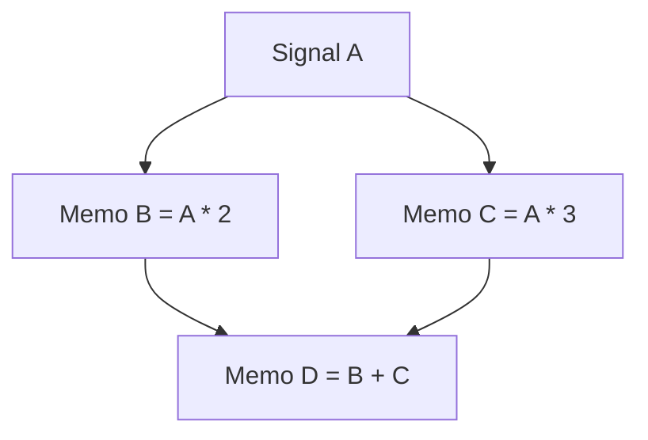

# Deep Reactivity & State Architecture Guide: `tej-core`

This guide explains the fine-grained, glitch-free reactivity system powering `tej-ui`.

---

## 1. Generational Arena & 8-Byte Copy Signals

Unlike traditional reactive frameworks that allocate an `Arc<Mutex<T>>` or `Rc<RefCell<T>>` for every variable, `tej-core` stores all reactive state inside a flat **generational slot arena** (`SlotMap`):

- **8-Byte Size**: `Signal<T>` contains only an 8-byte `SignalId` (32-bit slot index + 32-bit generation count) and a zero-sized phantom marker `PhantomData<T>`.
- **Copy Semantics**: `Signal<T>` is `Copy` and `Clone`. It can be passed freely into closures, tuples, and view builders without `.clone()` boilerplate or heap allocation.
- **Generational Safety**: If a scope unmounts and deallocates its signals, stale signal IDs automatically fail generation checks rather than accessing invalid memory.

```rust
let name = Signal::new("Antigravity".to_string());
let greeting = Memo::new(move || format!("Hello, {}!", name.get()));

// In closures, name is simply copied by value (8 bytes)
let on_click = move || name.set("Tej".to_string());
```

---

## 2. Glitch-Free Reactive DAG Evaluation

A "glitch" occurs in naive reactive systems when a derived computation evaluates with intermediate inconsistent state (the "diamond problem"):



If `A` changes, an uncoordinated system might recompute `D` after `B` updates, but before `C` updates, causing `D` to observe a transient, invalid value.

### Topological Ordering & Epoch Numbers
`tej-core` prevents glitches via two mechanisms:
1. **Epoch Bitsets**: Every signal has an epoch number. Writes increment the active epoch.
2. **Topological Sifting**: When `batch(|| { ... })` completes, dependent nodes in the DAG are evaluated in strict topological order according to their depth in the dependency graph. Dependent computations evaluate **exactly once per batch**.

---

## 3. The Reactive Primitives

### `Signal<T>`
Primary unit of mutable state:
- `sig.get()`: Clones current value and subscribes the caller.
- `sig.with(|v| ...)`: Borrows current value zero-copy within a closure.
- `sig.set(new_value)`: Writes new value and marks dependents dirty.
- `sig.update(|v| ...)`: Mutates value in-place without replacement.

### `Memo<T>`
Cached derived computation:
```rust
let count = Signal::new(5);
let square = Memo::new(move || count.get() * count.get());
```
`square` is only recomputed when `count` actually changes. If `count.set(5)` is called with an identical value, dirty propagation halts immediately.

### `create_effect(f)`
Side-effect coordinator:
```rust
let _effect = create_effect(move || {
    println!("Count changed: {}", count.get());
});
```

### `Store<T>`
Fine-grained proxy over structured data types with path-based subscriptions for nested objects.

### `Resource<T>`
Async data loader with loading, success, and error states:
```rust
let user_resource = Resource::new(user_id, |id| async move {
    fetch_user_by_id(id).await
});
```

---

## 4. Context API (`provide_context` & `use_context`)

Pass state implicitly down the view hierarchy without prop-drilling:

```rust
// In root container:
provide_context(Theme::dark());

// In any deeply nested child view:
let theme = use_context::<Theme>().expect("Theme must be provided");
```
